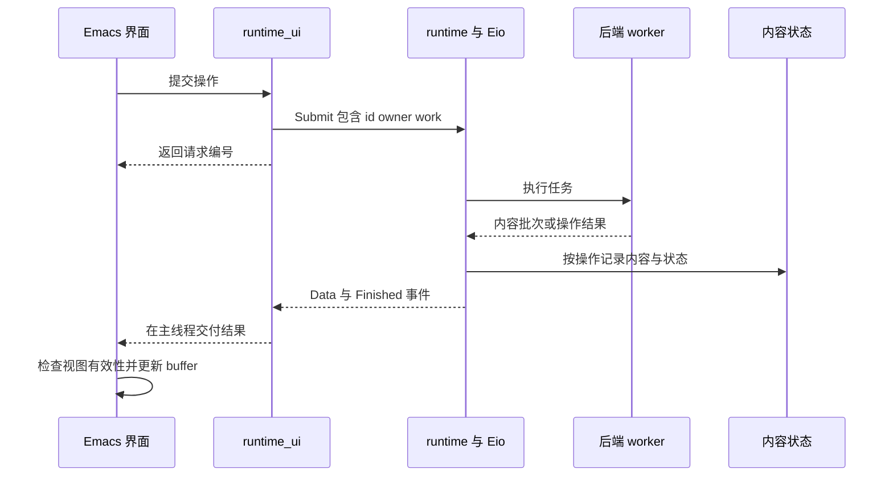

# Camulus 代码结构与总体设计

Camulus 把邮件、论坛和 feed 转换为统一的内容模型，提供时间线、回复树、已读状态和收藏归档。后端负责来源协议及其订阅语义；共享业务负责内容状态；Emacs 界面负责呈现和交互。OCaml 的模块系统描述能力边界，Eio 负责可取消的并发任务，Ecaml 将当前实现接入 Emacs。

界面、配置和宿主操作通过 Ecaml 接入 Emacs。公共模块位于 `src/`，各来源的协议与命令注册位于 `src/backends/`。本文按现有代码解释模块职责、请求流转和并发边界。

## 阅读源码的顺序

建议先读 [content.ml](../src/content.ml)，理解列表和正文交换哪些数据；再读 [backend.ml](../src/backend.ml)，理解必需接口与可选能力。接着用一个实际请求串起 [reader_ui.ml](../src/reader_ui.ml)、[runtime_ui.ml](../src/runtime_ui.ml)、[protocol.ml](../src/protocol.ml) 和 [runtime.ml](../src/runtime.ml)。最后查看某个后端及 [content_state.ml](../src/content_state.ml)。

不要先从 `camulus_native.ml` 的命令定义逐行读起。它是装配入口，理解各模块的职责后，里面的大部分注册调用才容易解释。

## 当前目录与编译边界

```text
src/
  content.ml                 消息、分页、渐进回复树和树排序
  backend.ml                 后端模块签名
  protocol.ml                任务、事件、取消和所有权
  runtime.ml                 后台 domain 与 Eio 调度
  runtime_ui.ml              Emacs 会话宿主、结果收发、通用状态操作
  content_state.ml            SQLite 内容状态与归档
  local_subscriptions.ml     后端选择使用的本地组订阅状态
  http.ml                    公共 HTTP 类型、URL 策略与 ocurl 执行
  html.ml                    Lambda Soup DOM 上的阅读正文清理与媒体提取
  credentials.ml             凭据文件读写与 Firefox Cookie 提供器
  credentials_emacs.ml       Emacs auth-source 查询和延迟 secret 解析
  reader_backend.ml          当前 Emacs 能力注册与 worker 注册
  reader_config.ml           Customize 配置、入口校验和优先级选项
  reader_ui.ml               时间线、组、收藏、阅读窗口
  writing.ml                 撰写会话、自动保存、关闭与发送协调
  reader_tracking_ui.ml      通用远端会话追踪面板
  reader_media.ml            正文媒体的 Emacs 呈现
  reader_webkit.ml           Emacs WebKit 页面与消息通道
  firefox_cookies.ml         可复用的 Firefox 凭据读取能力
  host.ml / host_stubs.c     宿主通知和信号保护
  camulus_native.ml          链接后端、注册命令、装配 Emacs 界面
  backends/
    reddit/
    discourse/
    mu/
    rss/
    jsonfeed/
    ...
lisp/camulus.el              autoload 和原生模块加载
nix/                        Emacs WebKit 的打包
patches/                    Ecaml 与 Eio 的宿主适配补丁
test/                       OCaml 测试、Emacs 集成测试、协议模拟服务
```

物理上同在 `src/`，不意味着所有模块都依赖 Emacs。[src/dune](../src/dune) 定义了三个主要编译单元：

| 编译单元 | 内容 | 是否依赖 Ecaml |
| --- | --- | --- |
| `reader` | 内容、状态、协议、运行时和一些宿主工具 | 否 |
| `reader_emacs_backend` | `reader_backend`、`reader_webkit`、`credentials_emacs`、`writing` | 是 |
| `camulus_native` | 原生入口、公共界面、配置、运行时宿主 | 是 |

每个后端也区分协议库和 Emacs 适配库。例如 `reddit_backend` 处理 HTTP、OAuth 和内容，`reddit_emacs` 注册命令、快捷键及 worker。源码归入同一个后端目录，是为了便于按功能查找；Dune 的库依赖才决定代码能否在没有 Emacs 的情况下使用。

## 后端模块与运行时注册

### 模块签名描述后端能做什么

[backend.ml](../src/backend.ml) 中的 `module type S` 是一个 OCaml 模块签名。实现它的模块需要提供自己的会话类型 `t`、组类型 `group`、游标类型 `cursor`，以及列表和搜索操作。这里的 `S` 是签名名称，并不代表一个后台线程或服务实例。

抽象类型让后端保留自己的模型：Discourse 可以使用 `Latest`、`Category`、`Topic`、`Notifications` 等变体，RSS 可以使用 feed URL，邮件可以使用本地查询或邮件目录。公共界面边界再把组和游标转换成字符串。

`Threading`、`Voting`、`Liking`、`Writing`、`Subscription` 和 `Topic_tracking` 是独立的可选签名。RSS 无须伪造 thread，单向点赞也无须伪造反对票。`Subscription` 的 `target` 和 `settings` 属于后端，所以论坛的追踪级别不会被压缩成统一的布尔开关。

目前基本签名仍包含 `search`；不支持某种搜索的入口由后端拒绝。例如 Discourse 通知流不提供远端搜索。声明签名本身不会自动生成界面能力或完成注册。

### Functor 注入依赖

Reddit、RSS 等后端使用 `Make (Transport : Http.S)`。Functor 可以理解为“接收模块、返回模块”的函数：真实运行传入网络传输模块，协议测试传入可控制响应的传输模块。调用者仍使用同样的 `list`、`read` 或写入操作。

这里隔离的是 HTTP 依赖，便于控制分页、失败、超时和认证响应；不是为了测试而额外创建一个业务层。实际网络和 Emacs 集成仍需要另外验证。

JSON Feed 的格式解析交给外部 `jsonfeed` 库，当前只接受 1.1。Camulus 保留版本检查、HTML 清理、URL 解析和到 `Content.message` 的转换。[jsonfeed_backend.ml](../src/backends/jsonfeed/jsonfeed_backend.ml) 不再依赖自写 `decode.ml`。RSS 和 JSON Feed 的 Emacs 接入通过 [rss_emacs.ml](../src/backends/rss/rss_emacs.ml) 中的 `Connect` functor 复用；各自保留解析器、分页游标和后端状态。

### 注册把能力接入运行中的程序

[reader_backend.ml](../src/reader_backend.ml) 目前提供两类注册：

| 注册对象 | 谁调用 | 用途 |
| --- | --- | --- |
| 界面能力记录 `t` | Emacs 主线程 | 如何打开文章、显示按钮、删除、修改订阅和呈现结果 |
| `host` 与 `worker` | 主线程创建宿主，后台创建会话 | 如何获取列表、下载归档、执行后端任务 |

`worker` 用 `matches_source` 声明负责哪些来源。公共运行时通过这个函数选择后端，调用 `page`、`archive` 或 `execute`；不再包含站点名称列表和具体后端分支。`archive` 的 `refresh` 参数要求后端在归档更新时重新验证自己的缓存，缓存如何更新仍由后端决定。

后端可以扩展 `Protocol.work` 和 `Protocol.payload`，也可以发布通用的 `Presentation` 数据。界面一侧的 `Value.t` 不应进入 worker。准备函数应在主线程读取配置，后台闭包只捕获普通 OCaml 数据。

`camulus_native.ml` 仍会列出要链接和安装的后端模块。这是构建与装配清单，不承担协议分派。当前扩展方式是加入 OCaml 模块并重新构建，不是运行时扫描第三方插件文件。

## 内容身份与回复树

[Content.message](../src/content.ml) 中，`id` 标识一条内容；`thread_id` 可选，表示来源真正提供的会话标识；`parent_id` 和 `references` 描述回复关系。状态存储使用 `(source, id)` 作为内容身份，避免两个站点相同的数字 ID 相互覆盖。

同一条内容通过组、搜索、通知或收藏进入时，应得到同一个身份，才能共用已读和收藏状态。后端不能为了区分入口给同一条内容随意创造新 ID。

邮件可以没有稳定的原生 thread ID。`content_state.ml` 的 `components` 根据父消息、引用关系和可用的原生会话关联构造连通分量，用于列表合并与归档覆盖判断。这个内部结果不是邮件协议中的永久 thread ID，也不按相同标题强行合并邮件。

`Content.tree_order` 负责显示顺序：同一父节点下按来源时间排序，时间相同再按 ID 排序；缺失父节点的消息仍保留，循环关系不会导致无限遍历。这个函数组织已有消息，并不负责获取缺失回复。

渐进加载通过 `thread_batch` 表达：`messages` 是本批消息，`gaps` 描述未展开的部分，`complete` 表示后端是否完成该次会话读取。Emacs 界面合并批次并保持阅读锚点；只有后端知道远端是否还有内容。

## 一次请求如何完成



以组刷新为例，`Reader_ui.load_list` 提交 `Content_state.Refresh`。`runtime_ui.ml` 的状态处理调用匹配的 worker，拿到 `Content.page` 后写入入口快照，再返回列表行和已读、收藏状态。`reader_ui.ml` 更新对应 buffer。搜索也走后端，但搜索结果不会被当作新的订阅入口。

文章阅读通常由后端注册的 `read` 能力提交专属任务；后端可以逐批返回正文和回复树。用户关闭或切换视图后，即使响应已经在路上，Emacs 界面仍需要判断它是否属于当前视图，不能仅凭“请求成功”更新屏幕。

收藏流程则先获取正文和所需资源，再提交归档和收藏关系。整条 thread 的归档需要后端报告完整；下载失败不能留下一个看似成功却内容不全的收藏。

## OCaml effects 与并发边界

### Eio 承担 effects 调度

[Runtime.worker](../src/runtime.ml) 在独立 OCaml domain 中运行 `Eio_posix.run`。一个 domain 可以运行多个 Eio fiber；fiber 在等待网络、定时器或 promise 时让出执行机会。后端可以保持顺序代码风格，同时允许其他任务继续执行。

当前 Camulus 没有另外定义一套自有的 `Effect.perform` 协议。应用操作用普通 OCaml 变体表示，异步等待和取消交给 Eio。增加一个后端不需要为每种 API 请求定义新的语言 effect。

同一个 Eio domain 上的多个 fiber 并不等于多个并行 CPU 执行线程。长时间纯计算或阻塞 C 调用仍可能拖住该 domain。SQLite 等阻塞工作通过 `Eio_unix.run_in_systhread` 执行，并通过 mutex 串行保护本地存储操作。

### Saturn 队列连接主线程与后台

SPSC 意为单生产者、单消费者。它适用于当前固定的两个执行端点，并不属于邮件协议。

| 队列 | 生产者 | 消费者 | 容量 |
| --- | --- | --- | --- |
| 命令 | Emacs 主线程 | Eio worker domain | 256 |
| 事件 | Eio worker domain | Emacs 主线程 | 512 |
| 邮件进程请求 | Eio worker domain | Emacs 主线程 | 64 |

三条队列都直接使用 `Saturn.Single_prod_single_cons_queue`。多个 fiber 在同一个 worker domain 中依次调用队列操作，队列操作内部没有 Eio 等待；如果将来允许多个 domain 同时写同一条队列，需要重新选择并发结构。

队列保存数据，管道负责唤醒。主线程提交命令后通知 worker；worker 发布事件后写入 Emacs 通知管道。Emacs process filter 在主线程消费结果，同时有 20ms 定时补偿。一次最多消费 64 个运行时事件，避免大量结果长时间占用界面事件循环。

命令队列满时，提交返回失败，调用者不能把操作当作已接受。事件队列满时，后台 fiber 等待并检查停止请求。停止使用独立原子标记，因此不要求先在已满队列中排入一条停止消息。

### 取消和过期响应

`Protocol.request` 包含 `id`、`owner` 和 `work`。`owner` 为 `View generation` 或 `Service`：前者可随视图关闭取消，后者允许操作离开当前视图后继续完成。运行时最多容纳 32 个活动任务，等待发布终态的任务也计入限额。

取消通过 promise 和 `Eio.Fiber.first` 传播。Emacs 界面同时检查视图代次和 buffer 内的请求 token；存储刷新还检查入口版本，阻止较早发出的慢响应覆盖较新的列表快照。这几处检查分别保护任务生命周期、界面和持久状态，不能相互替代。

取消本地等待不表示远端写入已经撤销。当前 `voting.ml` 的 `Pending` 等状态是会话内乐观展示及结果协调，既不是持久离线队列，也不意味着等待下一轮定时同步才发送请求。通用离线写入重试尚未实现。

## 组 订阅 时间线与优先级

组是浏览入口，由来源和组标识组成。`camulus-groups` 为它增加名字，注册组不会订阅，取消订阅也不删除浏览入口。首页顶部的后端按钮按后端筛选这些已注册入口。

订阅是后端提供的可选能力。RSS 只需要记录关注哪些 URL；Discourse 从服务器读取会话追踪状态，并提供远端追踪管理面板。Discourse 时间线使用已注册且已认证站点的会话通知，不把浏览全站等同于订阅全站，也不保留另一套“回复我的”组订阅。

主页向各后端的 `followed` 能力询问个人来源，允许立即返回或异步返回。它合并这些来源、应用优先级筛选，再调度入口刷新；当前主页最多同时刷新 4 个入口。后端可提供没有单独注册浏览组的通知流，显示名字则尽量复用已有组配置。

优先级属于本地呈现偏好，作用于一个完整订阅来源 `(source, group)`。同一 Discourse 站点的通知流共用一个优先级，当前不区分其中各话题。

| Emacs 选项 | 含义 |
| --- | --- |
| `camulus-subscription-priorities` | `(SOURCE GROUP LEVEL)` 列表 |
| `camulus-default-subscription-priority` | 没有单独设置的来源级别，默认为 2 |
| `camulus-home-priorities` | 主页显示哪些级别，`nil` 表示全部 |

级别为非负整数，较小值代表较高优先级；可以约定 1 为重要、2 为普通、3 为稍后阅读。筛选采用明确的级别集合，不是阈值。列表内部仍按来源时间排序，不因优先级改变文章时间顺序。

```elisp
(setopt camulus-subscription-priorities
        '(("reddit:alice" "ocaml" 1)
          ("discourse:https://emacs-china.org" "notifications" 2)
          ("jsonfeed:https://anil.recoil.org/feeds/feed.json"
           "https://anil.recoil.org/feeds/feed.json" 3))
        camulus-default-subscription-priority 2
        camulus-home-priorities '(1 2))
```

`U` 打开全部订阅，`p` 设置光标处来源的优先级；主页 `P` 或顶部 Priorities 按钮选择显示级别。这些交互通过 Customize 保存。修改配置文件中的 `setopt` 后刷新主页生效。

筛选不会执行取消订阅、已读或移除。被隐藏的来源仍出现在订阅面板，注册的组也仍可浏览；主页不为被筛掉的入口发起列表刷新。重新显示某一级别时，原有内容状态保持不变。

## 本地内容状态与归档

[content_state.ml](../src/content_state.ml) 使用 SQLite 保存内容状态，不负责决定订阅谁。数据库中的历史订阅表仅用于已有数据迁移，当前入口注册和后端订阅有各自的权威来源。

| 数据 | 主要用途 |
| --- | --- |
| `items` 与 `item_links` | 内容身份、标题、来源时间、已读和回复关联 |
| `entry_members` | 某个已获取入口当前包含哪些内容 |
| `activities` | 同一内容的不同进展及发现序号 |
| `dismissals` | 列表已经移除到哪个进展 |
| `folders` 与 `favorites` | 嵌套文件夹及收藏关系 |
| `archives` 与 `archive_files` | 持久正文、原始 MIME 和媒体字节 |

### 已读与移除相互独立

已读在正文进入阅读窗口可见区域后更新；后台取回正文不会自动标记已读。普通列表用灰色表示已读，用红色表示收藏，收藏夹内不重复使用收藏红色。

`d` 默认移除当前列表中已经处理的进展。活动序号记录移除边界，来源时间负责显示排序；它们不是同一个时间概念。新的活动版本可以重新出现，重复拉取同一版本不应复活已移除的条目。统一时间线也会合并跨入口的相同活动，避免仅因新增一个入口而重复提醒。

邮件通过后端的 `delete` 能力覆盖这个默认动作，移动到 Trash，并通过邮件同步流程反映到远端。收藏夹中的 `d` 只移除当前收藏关系。搜索结果目前不支持列表删除操作。

### 收藏意味着持久保存

收藏关系的键包含文件夹、来源、目标类型和目标 ID。同一篇文章可以加入多个文件夹，单独一楼和整条会话可分别出现。文件夹只显示直接归属的收藏，不汇总子文件夹内容。

归档保存正文及所需资源。邮件可以保留原始 MIME，以便离线提取附件；网页内容可以保存图片和其他媒体。下载与数据库提交分开，提交使用事务。取消最后一个覆盖某条内容的收藏关系后，当前实现会清理失去覆盖的归档。

删除文件夹通过外键级联取消该文件夹及子文件夹中的关系，再清理没有其他收藏覆盖的归档；不会创造阻止远端再次获取的删除标记。

收藏的后续更新通过 `Refresh_archives` 重新获取并提交，按收藏目标去重。现有任务机制能够执行刷新，但并不代表已经具备所有后端的持续增量同步服务。

## 邮件进程 WebKit 与凭据的归属

[mu/process.ml](../src/backends/mu/process.ml) 是当前邮件后端的外部进程桥。worker 请求执行 `mu` 或 `mbsync`，主线程中的 [process_emacs.ml](../src/backends/mu/process_emacs.ml) 通过 Emacs process API 创建进程并交回结果。这样保留 Emacs 对子进程和 SIGCHLD 的管理。SMTP 使用 OCaml 邮件与 TLS 库，不经过这个进程桥。

未来 JMAP 后端可以直接使用 HTTP，不需要实现相同的外部进程机制。公共 `Runtime` 不要求所有后端都能启动子进程。

[reader_webkit.ml](../src/reader_webkit.ml) 的接口负责打开页面、接收受限消息和关闭页面，属于 Emacs 宿主能力。正文的 SHR、图片和内联视频由 Emacs 界面呈现。它们不应变成来源协议库的硬依赖。

[firefox_cookies.ml](../src/firefox_cookies.ml) 读取明确配置的 Firefox profile，筛选适用于 HTTPS 目标的未过期 Cookie。它不自行登录网站，也不是用户所有后端必须使用的全局认证系统。知乎和豆瓣可以选择它，其他后端可以使用 OAuth、User API Key 或自己的凭据机制。

[host_stubs.c](../src/host_stubs.c) 则处理通知管道的 SIGPIPE 保护和信号检查。Ecaml 与 Eio 补丁分别解决当前运行时与 Emacs 宿主之间的适配问题。这类代码需要跟随宿主运行环境维护，不能当作来源业务的一部分。

## 添加后端时需要改什么

1. 在 `src/backends/` 中建立来源目录，定义会话、组、分页与认证模型，实现需要的基础和可选能力。先确认内容 ID 和来源 ID 的稳定规则。
2. 使用外部库处理标准协议或格式；只保留来源特有的数据转换、HTML 选择和业务规则。网络请求应可取消，避免在 worker domain 中长期阻塞。
3. 注册 worker 的来源匹配、分页、归档与执行能力。可扩展 `Protocol.work`；普通内容结果也可使用共享呈现格式。
4. 为 Emacs 界面注册可用操作、可定制选项和时间线来源。协议模块不应调用 Ecaml。
5. 在 Dune 和 `camulus_native.ml` 的装配清单加入该适配模块。公共运行时不应新增后端名称分支。
6. 验证稳定身份、分页、错误与取消、订阅权威来源、归档，以及至少一条真实 Emacs 操作路径。

[Reddit](../src/backends/reddit/reddit_emacs.ml) 可作为独立协议任务注册的例子；[JSON Feed](../src/backends/jsonfeed/jsonfeed_emacs.ml) 展示通过 functor 复用接入；[Discourse](../src/backends/discourse/discourse_emacs.ml) 展示多个站点和远端追踪能力。

## 公共 HTTP 与凭据读取

[http.ml](../src/http.ml) 定义共享的请求、响应和 HTTP 方法，以及基于 ocurl multi 的 Eio 传输。RSS、Reddit、Discourse 和使用 RSS 传输的内容后端不再各自维护 `curl_transport.ml`。传输统一处理 TLS、证书、连接与总超时、取消及句柄清理；不自动重试、不跟随重定向，也不查找或注入凭据。

后端在自己的 `Transport` 模块指定 URL 策略：RSS 接受 HTTP/HTTPS，Reddit 只接受 HTTPS，Discourse 允许 HTTPS 和测试用的 loopback HTTP。具体的认证请求头、凭据发送目标及重定向规则由后端决定。例如 Discourse 媒体下载只向同源且符合站点挂载路径的地址附加密钥，RSS 的跨域重定向不携带其他来源的认证信息。

[credentials.ml](../src/credentials.ml) 负责有大小上限的凭据文件读取、调用者选择的私有文件权限检查，以及 0600 临时文件加原子替换的保存。允许读取 agenix 等机制提供的符号链接，保存时拒绝覆盖符号链接。Reddit 的刷新令牌和 Mu 的 SMTP 密码复用该模块；读取在 Eio 系统线程中执行。浏览器凭据通过 `Credentials.Firefox` 提供，仍使用既有只读 Firefox Cookie 实现。

[credentials_emacs.ml](../src/credentials_emacs.ml) 在 Emacs 主线程查询 `auth-source`，解析函数形式的 secret，并返回普通 OCaml 字符串。临时凭据来源在查询结束或异常后恢复；Discourse 可继续使用 `discourse-auth` 的当前授权会话，否则使用公共查询接口。后端保留授权协议、scope、令牌刷新、账户选择与认证失效处理。

## 通用辅助代码与外部库

标准格式和并发容器适合交给已有库，来源特有规则则保留在后端。当前已经使用 Saturn、`jsonfeed`、Syndic 和 Lambda Soup，分别处理并发队列、JSON Feed 1.1、RSS/Atom 和 HTML DOM。邮件 MIME 和 SMTP 依赖 Mrmime、Colombe 等库。RSS 标准字段和日期交给 Syndic；`feed_xml.ml` 只保留站点扩展元数据和 XHTML 到阅读正文的适配；XHTML 序列化和转义使用 `Syndic.XML.to_string`。HTML 使用 Lambda Soup 的 DOM、遍历及序列化，不再维护自写节点类型或 HTML 大小、深度和节点配额；`Html.clean` 原地清理传入 DOM，站点特有的图片属性与段落换行通过 Soup 节点操作处理。Blogger 直接使用 Syndic 的 Atom 链接读取分页；The Atlantic 只额外解析题图的 Media RSS 扩展。

下一步值得检查的部分：

| 当前实现 | 可考虑的替代 | 需要保留的职责 |
| --- | --- | --- |
| [Html](../src/html.ml) 的解析、DOM 遍历与序列化 | 已使用 [Lambda Soup](https://github.com/aantron/lambdasoup) | 内容清理策略、媒体提取、站点正文选择规则 |

这些是后续替换候选，不表示当前代码已完成迁移。`Html` 已经借助 Markup 解析 HTML；继续引入 DOM 库的收益主要是查询和重写，不应把整个模块称为自写 HTML 解析器。重复的字符串搜索和 HTML 转义也可先复用已有辅助函数，无须为每个小函数增加一个依赖。

## 验证与当前限制

`nix develop -c make test` 同时运行 OCaml 测试和独立 Emacs 批处理进程中的集成测试，HTTP 与 SMTP 写入使用本地模拟服务。队列、取消、过期响应、界面焦点、归档、订阅和优先级筛选分别由对应测试覆盖。打包后的 `test/package-startup.el` 另外检查安装产物是否能够实际加载。

[VALIDATION.md](VALIDATION.md) 是早期运行时验证记录，其中日期与范围只属于当时的实现；当前行为应以源码、当前测试和本页的实现边界为准。

仍需持续注意：

- 界面边界有 `Yojson` 与 Lisp alist 的动态字段约定，OCaml 模块签名不能检查所有呈现字段。
- Mu 邮件同步在进入首页或邮件组以及手动刷新时触发，默认不定时轮询；这不等于已经具备持久离线写入队列。
- 归档刷新当前由任务触发；不同来源的增量更新能力、写入支持和编辑界面完整度仍不同。
- 新原生模块需要新的 Emacs 进程才能替换已经加载的模块，更新 Lisp 入口不足以替换 OCaml runtime。

## 撰写会话

[writing.ml](../src/writing.ml) 集中管理 Emacs 编辑 buffer 的生命周期：编辑版本、自动保存定时器、保存中的修改、关闭前保存及发送状态。后端用 `snapshot` 提供当前正文，用 `save` 和 `send` 提供异步完成回调。公共模块不解析邮件头，不决定草稿保存目录，也不实现发送协议。目前 Mu 撰写界面已接入。

保存只确认提交时的 buffer 修改版本。若等待落盘期间又有编辑，旧保存结果不会清除新修改；会继续保存新版本。保存失败后停止自动重试，手动保存、关闭或发送可以重新尝试保存。关闭失败会保留编辑 buffer。

发送先持久保存草稿，并在等待保存时预留发送状态、将 buffer 设为只读，避免事件处理期间重复提交。后端确认发送成功后，即使本地清理未完成，也将会话置为已发送并阻止重发。失败时恢复编辑；不自动重试发送。不确定远端结果的持久防重仍由后端处理。
